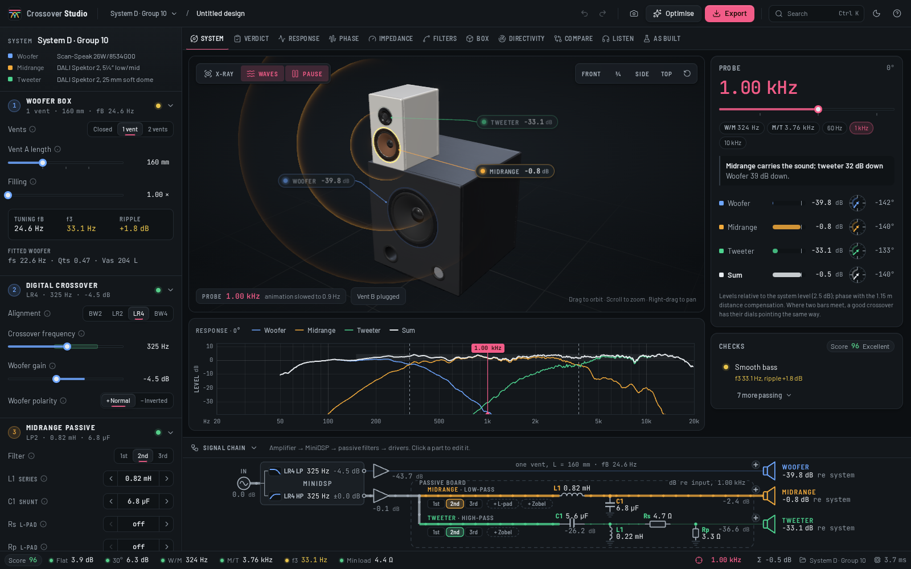
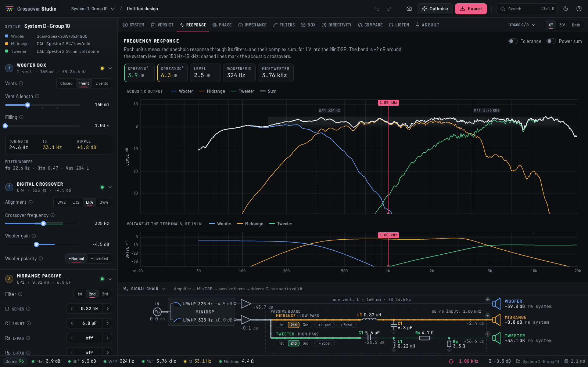
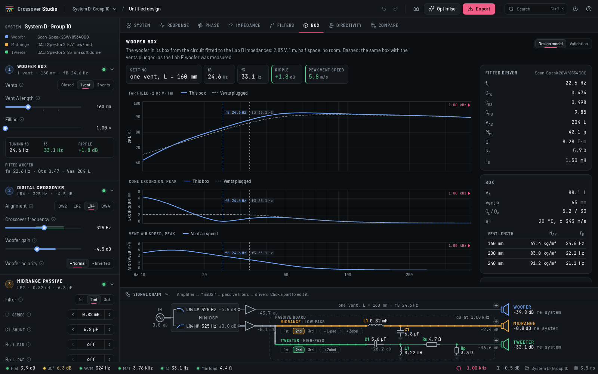
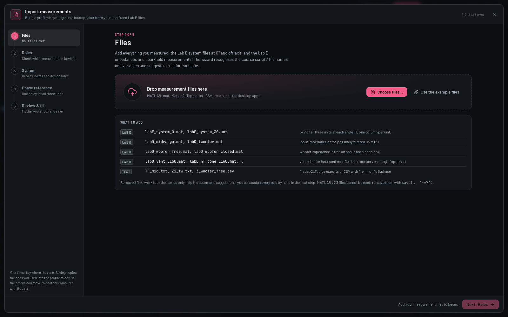
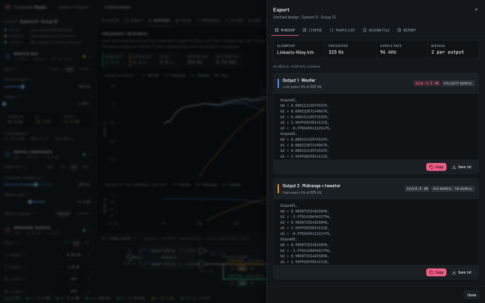

# Crossover Studio

**Design the three-way loudspeaker of DTU 34870 Electroacoustics from your own lab measurements.**

Crossover Studio is a desktop app for Linux and Windows. It covers the whole project system: the woofer in a
vented box behind the MiniDSP low-pass, and the midrange and tweeter behind the MiniDSP high-pass and a passive
crossover. Load your group's Lab D and Lab E files once. After that, every slider, part value and vent length
recomputes the system from your measurements in under a millisecond. The 3D model, the curves, the signal
chain and the design checks follow as you drag. When the checks are green, export the MiniDSP biquads, a
ready-to-run LTspice schematic and the parts list.

It does the same job as VituixCAD, but it is built around this one project. The inspector on the left follows
the project guide's steps in order. Every number has a unit and a hint, and you can only pick parts that are
in the course basket.



| | |
|---|---|
|  |  |
|  |  |

## Download and install

Installers are on the [Releases page](https://github.com/MadsRudolph/crossover-studio/releases).

**Windows 10/11**
- `Crossover.Studio_<version>_x64-setup.exe` installs for your user only and does not need admin rights.
  This is the one to pick.
- `Crossover.Studio_<version>_x64_en-US.msi` is for managed machines.
- The app is not code-signed, so SmartScreen may warn you. Click **More info → Run anyway**.

**Linux**
- **AppImage (any distribution):** `chmod +x Crossover.Studio_<version>_amd64.AppImage`, then run it. Some
  distributions need FUSE 2 for AppImages (`fuse2` on Arch, `libfuse2` on Ubuntu 22.04+).
- **Debian/Ubuntu:** `sudo apt install ./Crossover.Studio_<version>_amd64.deb`.

The app works fully offline. It needs no account and makes no network requests.

## Quick start: the bundled example

The app opens with **System D · Group 10** already loaded. This is the bundled example profile: a Scan-Speak
26W/8534G00 woofer in an 88 L vented box with a DALI Spektor 2 on top, as measured in Lab D and Lab E 2026. Use
it to learn the workflow before you import your own data.

1. **Box:** choose one vent, drag its length and watch f_B, f_3 and the bass ripple.
2. **Digital:** pick an alignment (LR4 is a good start) and drag the crossover frequency into the shaded band.
3. **Midrange / 4. Tweeter:** pick a topology, then step through the part values with ‹ ›.
5. **Check & export:** click any amber or red check to jump to the control that fixes it. You can also press
   **O** to let the optimiser search the basket values for you.

Press **Ctrl+K** for the command palette. Keys **1–9** switch views, **S** takes a snapshot to compare against,
and **E** opens the export.

## Importing your group's measurements

Click **Import measurements** (in the profile switcher, or with Ctrl+K). Drop in your files, check how they
were assigned, describe the boxes, and save. The result is a *profile*. Crossover Studio keeps it with copies
of the source files, so you can open it on any machine or zip it for your group.

**What you need**

| Measurement | From | Used for |
|---|---|---|
| Woofer, mid and tweeter p/V on axis (0°) | Lab E system run, e.g. `labE_system_0.mat` | **Required.** The acoustic sum. |
| The same at 30° (or any other angle) | Lab E, e.g. `labE_system_30.mat` | Off-axis check and directivity view |
| Midrange and tweeter input impedance | Lab D, e.g. `labD_midrange.mat`, `labD_tweeter.mat` | **Required.** The load of the passive filters. |
| Woofer impedance, free air and in the closed box | Lab D, `labD_woofer_free.mat`, `labD_woofer_closed.mat` | Fitting the driver (T/S parameters) |
| Woofer impedance in the vented box, per vent length | Lab D, `labD_vent_L160.mat`, … | Fitting the vent, so the box tuning is real |
| Near field at the cone and at the vent (optional) | Lab D, `labD_nf_cone_L160.mat`, `labD_nf_vent_L160.mat` | Validating the box model |

**File formats:** MATLAB `.mat` (v5–v7), the `.txt` files `Matlab2LTspice.m` writes, and CSV (re/im, or
magnitude/dB with phase, as REW exports it). A `.mat` file can hold several variables, or a matrix with one
column per unit. In the Lab E system files, `H(:,1:3)` is woofer, midrange and tweeter in that order. You can
pick the frequency and data variables yourself if the automatic guess is wrong.

**Naming tips.** The wizard reads file names, variable names and the `note`/`tag` text the lab scripts save.
Names like these get assigned without any clicks:
- the unit: `woofer`/`woof`, `midrange`/`mid`, `tweeter`/`tw`
- the angle: `system_30`, `TF30_mid`, `off30`, `30deg` (no angle means on axis)
- the vent length in mm: `vent_L160`, `L200`, `240mm`
- the quantity: `Z`/`imp` for impedances, `H`/`TF` for responses, `nf_cone`/`nf_vent` for near fields
- the woofer box state: `free`, `closed`/`plugged`

**MATLAB `-v7.3` files cannot be read.** That is the HDF5 format MATLAB uses for very large variables. Load the
file in MATLAB and save it again with `save('labD_tweeter.mat', '-v7')`. The app tells you when it meets one.

**Phase.** All three units must come from the *same* Lab E run, so their relative phase is valid. The wizard
asks for one phase reference distance for all units. This is the `d` you would give `Matlab2LTspice.m`; the
course uses a negative value such as −1.15 m to flatten the phase.

The file format is documented field by field in [docs/PROFILE_FORMAT.md](docs/PROFILE_FORMAT.md). A profile
can also be written by hand or generated from a script.

## Documentation

- [User guide](docs/USER_GUIDE.md): the project task by task (box tuning, crossover design, checks, export
  to the MiniDSP and LTspice, listening-test tips).
- [Profile format](docs/PROFILE_FORMAT.md): `profile.json`, the file that holds one group's system.
- [Design brief](docs/DESIGN.md): the visual and interaction rules the app follows.

## How we know the numbers are right

The engine is a TypeScript port of the Python and MATLAB models the course project was verified with, and its
tests check it against those models (`npx vitest run`):

- **System response.** Every unit's output, the complex sum at 0° and 30°, and the amplifier load agree with
  the reference Python model (`xover.py`) to within 2·10⁻⁵ relative. That is the precision the reference data
  is stored with. Crossover frequencies are identical.
- **Box fit.** The woofer fit (f_s, Q_ms, Q_es, V_as and the vent mass for each length) matches the Python
  `box_model.py` to better than 10⁻⁶.
- **MiniDSP text.** The biquad blocks and LTspice Laplace strings are byte-identical to what the course's
  `DigitalCrossover.m` prints.
- **LTspice export.** The exported data tables match `Matlab2LTspice.m`'s files to 10⁻³ dB. LTspice runs the
  exported schematic headless, and its V(Psum) at 0° and 30° matches the engine to 10⁻⁴ dB
  (`scripts/verify_ltspice.py`). This was checked for the reference design and for a stress design with
  3rd-order ladders, L-pads, a Zobel, coil resistance, an inverted unit and two vents.
- **Files.** The Rust readers are tested on the real lab `.mat`, `.txt` and `.csv` files (`cargo test`).

## Building from source

You need Node 22+, Rust (stable) and the
[Tauri 2 system dependencies](https://v2.tauri.app/start/prerequisites/). On Debian/Ubuntu:

```sh
sudo apt install libwebkit2gtk-4.1-dev libappindicator3-dev librsvg2-dev patchelf
```

On Windows, install the Visual Studio C++ build tools. WebView2 ships with Windows 10 and 11.

```sh
git clone https://github.com/MadsRudolph/crossover-studio.git
cd crossover-studio
npm ci
npm run tauri dev        # run the app with hot reload
npm run tauri build      # installers in src-tauri/target/release/bundle/
```

Checks:

```sh
npx tsc --noEmit -p .                          # types
npx vitest run                                 # engine, exporters and UI logic
(cd src-tauri && cargo test)                   # file readers and profiles
python3 scripts/verify_ltspice.py              # exported schematic in LTspice under wine (after vitest)
```

`npm run dev` runs the interface in a plain browser. The bundled profile works there, but opening and saving
files needs the desktop app.

**Releases** are built by GitHub Actions. Push a tag such as `v0.2.0` and a draft release appears with the
AppImage, `.deb`, NSIS `.exe` and `.msi` attached (`.github/workflows/release.yml`).

## Project layout

```
src/engine/      the acoustic model: box fit, digital and passive filters, sum, checks, optimiser
src/state/       the single app store (Zustand)
src/ui/          design system and application shell
src/views/       System, Response, Phase, Impedance, Filters, Box, Directivity, Compare
src/viewport3d/  the 3D loudspeaker
src/charts/      the canvas plotting library
src/schematic/   the live signal chain
src/wizard/      measurement import
src/export/      MiniDSP, LTspice, parts list and design files
src-tauri/       Rust backend: .mat / text readers, profile storage
profiles/        the bundled example profile
fixtures/        reference data and results the tests check against
```

## Credits

Built for the loudspeaker project of **34870 Electroacoustics** at the Technical University of Denmark (DTU),
autumn 2026. The project structure, the MiniDSP and LTspice conventions (`DigitalCrossover.m`,
`Matlab2LTspice.m`), the component basket and the design targets come from the course material. The example
measurements are Group 10's Lab D and Lab E data for System D.

Crossover Studio is an independent student tool. It is not an official DTU product, and the course staff do
not maintain it.

## License

[MIT](LICENSE) © 2026 Mads Rudolph
